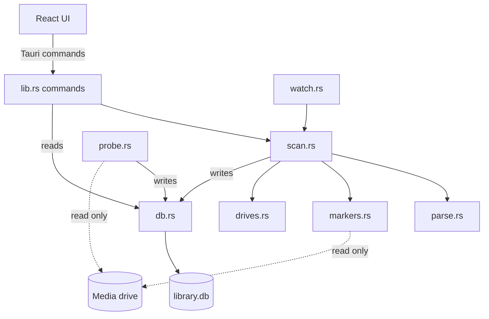
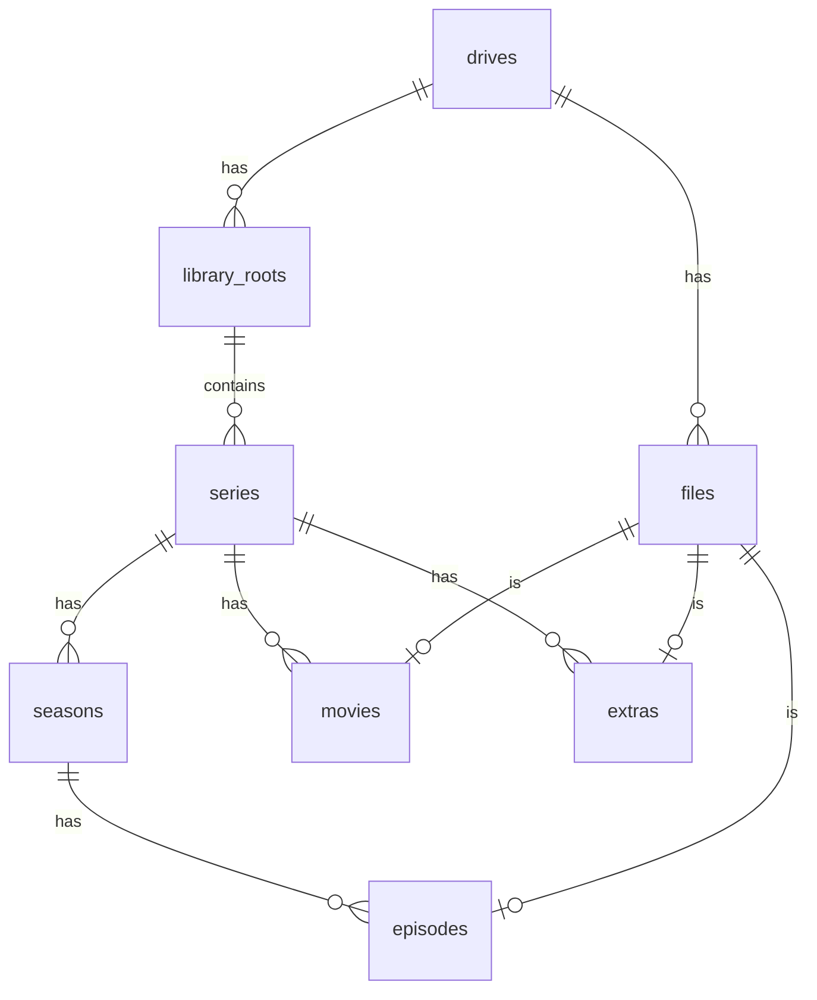
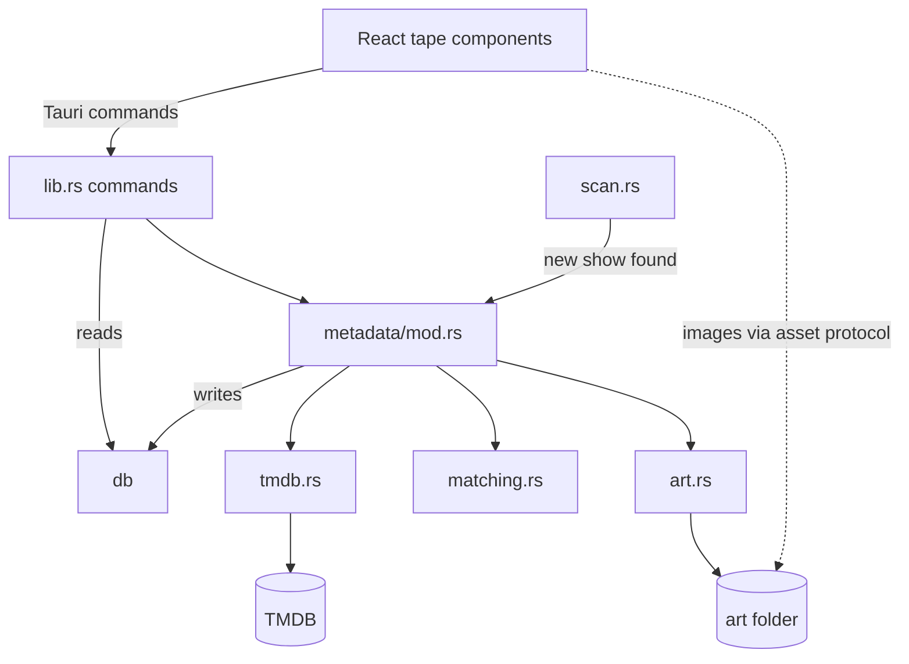

# Architecture

How the app fits together. One-way decisions and their reasons are in `docs/DECISIONS.md`.

## Library core (Phase 1, step 1)

Status: **approved 2026-11-22.** All 6 slices built.

### 1. Requirements

What it does:

- Finds the media drives that are plugged in, by volume UUID.
- Reads `Cartoons/` into a library: shows, seasons, episodes (with segments `a`/`b` and ranges `E03-E04`), specials, series movies and extras.
- Uses the tapehead markers (`.tapehead-series.yaml`) and `Cartoons/.tapehead/series.yaml` (`skip` hides, `keep` shows as-is).
- Parses folders with no marker too, and flags anything it can't place for the review queue.
- Reads duration and video size with ffprobe, in the background.
- Notices new, renamed or removed files while the app is open, and drives being plugged in or out.
- Keeps an unplugged drive's titles on the shelf, greyed out.

Limits:

- **Never writes to a drive.** The database lives in `~/Library/Application Support/FonyMediaCentre/library.db`.
- Opening the app shows the shelf from the database straight away. A rescan runs behind it.
- A rescan of Cartoons (without ffprobe) finishes in under 2 seconds.
- One user, one Mac, offline. No accounts, no server.

### 2. Size

Measured on Glitchy_2TB today:

| Folder | Video files |
| --- | --- |
| Cartoons | 2,793 (30 show folders) |
| Shows | 674 |
| Anime | 345 |
| Movies | 144 |
| Everything else | about 60 |

- Walking all of Cartoons takes about 15 ms once the drive's folder list is cached.
- One ffprobe call takes about 70 ms. 2,800 files is about 3.5 minutes one at a time, under a minute with 4 at once. It only runs for new or changed files, so after the first scan it is near zero.
- Even at 10x (40,000 files) the database is a few megabytes. SQLite handles that without trying. **The hard part is getting the parsing right, not speed.**

### 3. Parts

| Part (Rust module) | Its one job | Owns | Calls |
| --- | --- | --- | --- |
| `library/db.rs` | Opens the database, runs migrations, does every write | All library tables | SQLite |
| `library/parse.rs` | Turns a file path into show, season, episode, segment, title. Plain functions, no file access | Nothing | Nothing |
| `library/markers.rs` | Reads the tapehead YAML files (with `serde_norway`) | Nothing | The drive (read only) |
| `library/scan.rs` | Walks a folder, works out what changed since last time, hands the changes to `db` | Nothing | `parse`, `markers`, `db` |
| `library/probe.rs` | Runs ffprobe on files that need it, a few at a time | Nothing | ffprobe, `db` |
| `drives.rs` (grows from `volume.rs`) | Lists mounted drives and their UUIDs | Nothing | `diskutil` |
| `watch.rs` | Tells `scan` when files or mounted drives change | Nothing | macOS file events |
| `lib.rs` | The commands the UI calls | Nothing | `db` (reads), `scan` |

Only `db.rs` touches SQLite. Only `scan.rs` and `probe.rs` read the drive. The UI never sees a path it can open itself; it asks Rust to play a file by id.

### 4. Main journeys

**App opens**

1. UI asks for the library. `db` returns what was there last time, with each drive marked online or offline. (instant)
2. In the background, `drives` lists what's mounted and matches UUIDs to known drives.
3. For each online drive, `scan` walks each library folder, compares with the `files` table (path, size, modified time) and writes only the differences in one transaction.
4. Rust sends a `library-changed` event. UI refetches.
5. `probe` works through files with no ffprobe data, writing results in small batches, sending `library-changed` every batch.

**A file changes while the app is open** (tapehead renames, a new show is copied in)

1. `watch` gets file events for that folder and waits 2 seconds for things to settle.
2. `scan` rescans that whole library folder. It's fast enough that working out which show changed isn't worth the code.
3. Same as steps 3 to 5 above.

**A drive is unplugged**

1. `watch` sees the volume leave `/Volumes`.
2. The drive is marked offline. Nothing is deleted. The UI greys its tapes out.
3. When it comes back, it's rescanned.

### 5. Commands (UI to Rust)

All return `Result<T, String>` like the existing mpv commands, with a plain error message.

| Command | Does | Returns |
| --- | --- | --- |
| `library_overview` | Everything the shelf needs: series, seasons, movies, with drive online state | A list, small enough to send whole (30 shows) |
| `library_series(id)` | One show's episodes, specials and extras in play order | A list |
| `library_rescan` | Starts a rescan now | Nothing; progress comes as events |
| `library_review_queue` | Files the scanner couldn't place, and untidy folders | A list |

Playing a file moves from `mpv_load(path)` to `play_file(file_id)`: Rust looks up the path, so the UI never handles raw paths.

### 6. Database

SQLite, WAL mode, foreign keys on. Ids are plain integers (local only). Times are UTC ISO strings. Paths are stored **relative to the drive**, so a drive mounted under a different name still matches.

| Table | Key columns | Notes |
| --- | --- | --- |
| `drives` | `volume_uuid` UNIQUE, `name`, `last_mount_point`, `last_seen_at` | Online or offline is worked out at runtime, not stored |
| `library_roots` | `drive_id`, `rel_path` (e.g. `Cartoons`), `kind` (cartoons, movies, shows), `enabled` | UNIQUE (`drive_id`, `rel_path`). The editor's include/exclude later. Seeded with Cartoons only |
| `series` | `root_id`, `folder` UNIQUE per root, `name`, `year`, `tmdb_id`, `mode` (tmdb, local, keep), `source` (marker, series_yaml, parsed), `is_tidy` | `skip` folders are not stored at all |
| `seasons` | `series_id`, `number` (0 = Specials) | UNIQUE (`series_id`, `number`) |
| `episodes` | `season_id`, `file_id` UNIQUE, `episode`, `episode_end` (null unless a range), `segment` (null, a, b), `title` | Index on (`season_id`, `episode`, `segment`) for play order |
| `movies` | `series_id`, `file_id` UNIQUE, `title`, `year` | `series_id` nullable later for standalone films (Movies folder) |
| `extras` | `series_id`, `file_id` UNIQUE, `title` | Played after the last season |
| `files` | `drive_id`, `rel_path`, `size`, `modified_at`, `duration_ms`, `video_codec`, `width`, `height`, `probed_at` | UNIQUE (`drive_id`, `rel_path`). Index on `probed_at` for the probe queue |

Not in this step:

- **Tapes, user overrides, watch progress.** They come with the shelf (step 4), the editor (step 6) and the player (step 5), as new migrations. Today a tape is simply "one season" or "one movie", worked out on read.
- **Audio tracks.** mpv reports them when a file plays, so storing them buys nothing yet.
- **The review queue** is a query (files with no episode, movie or extra; series with `is_tidy = 0`), not a table.

Removing rows: a file that's gone from an **online** drive is deleted, along with its episode row. Files on an **offline** drive are never touched.

Migrations: numbered `.sql` files built into the app, tracked with SQLite's `user_version`. No migration library.

### 7. Caching

None. The database is the cache of the drive, and every query is tiny.

### 8. When things go wrong

| Problem | What happens | What Glitchy sees |
| --- | --- | --- |
| Drive unplugged mid-scan | Scan stops, writes nothing for that drive | Tapes grey out |
| ffprobe missing or fails on a file | That file is skipped and retried next launch | Tape shows no running time |
| A file name can't be parsed | File goes to the review queue | Listed in the editor (later), counted on the dev screen now |
| Bad YAML in a marker | Folder treated as unmarked, parsed from file names | Flagged in the review queue |
| Database file corrupt | App starts with an empty library and rebuilds it by rescanning (nothing in it can't be rebuilt yet) | A one-line notice |
| tapehead renames files | The old paths disappear and new ones appear on the next scan | Nothing; the show looks the same |

Logs record what failed and which step, never the full path list.

### 9. When it would need to change

- **The other folders** (Movies, Shows, Anime) aren't tidy. Adding them is a new `library_roots` row plus parse rules for films, not a redesign.
- **Watch progress keyed by file** would be lost when tapehead renames a file. Decide in the player step whether to key it by show, season and episode instead (see DECISIONS).
- **Phase 3 (Pi)** reads the same schema. Nothing here is macOS-only except `diskutil` and file events, both behind one module each.

### 10. Build order

Each is one `plan-ticket` slice and ends with something Glitchy can check.

1. **Database and drives.** Create the database, run migration 1, record Glitchy_2TB, report online or offline. Check: the dev screen shows the drive.
2. **Parser.** Port tapehead's rules for the tidy layout (`SxxEyy`, segments, ranges, Specials, Movies, Extras) plus marker reading. Rust tests copied from tapehead's cases. Check: `cargo test`.
3. **Scanner.** Walk Cartoons into the database, with the rescan command and a count on the dev screen. Check: 30 shows minus hidden ones, about 2,800 files placed, the rest listed.
4. **ffprobe.** Background probing. Check: running times filled in, app stays responsive.
5. **Watching.** File changes and plug/unplug. Check: rename a test copy or unplug the drive and watch the dev screen update.
6. **Unmarked folders.** Parse He-Man and Looney Tunes as far as tapehead's loose rules allow; the rest to the review queue.

## Metadata and art (Phase 1, step 2)

Status: **approved 2026-11-22.** All 5 slices built.

### 1. Requirements

What it does:

- Finds each show on TMDB. It uses the `tmdb_id` from the marker when there is one, and searches by name and year for the rest.
- Saves what the tapes need: the show poster, the transparent title logo, each season's poster, and the show and season overviews for the back cover.
- Downloads the images once into `~/Library/Application Support/FonyMediaCentre/art/`. They are never written to a drive.
- Picks a spine colour from each poster.
- Draws the tape parts in the UI from that data: front case (poster), spine (logo on the poster colour, season number underneath) and the two wall posters (show poster on the left, season poster on the right, show poster again if the season has none).

Limits:

- **Works offline.** With no network or no key, tapes still show, with a plain handwritten spine and no poster.
- **Never guesses.** A search only counts when the name and year match exactly. Anything else stays unmatched for the editor (step 6), the same rule tapehead follows.
- The TMDB key is read only in Rust and never reaches the UI or the logs.

### 2. Size

Today: 30 shows (23 with a marker id, 7 without), 114 seasons, 4 series movies.

- **API calls:** one `/tv/{id}` call per show also returns its seasons and images (`append_to_response=images`). So 23 calls, plus 7 searches, plus about 8 for the movies: **about 40 calls in total.** TMDB allows roughly 40 a second, and we make 4 at a time.
- **Images:** 30 posters, 30 logos, up to 114 season posters, 4 movie posters: **about 180 files.** Posters at 780 px wide are about 120 KB, logos about 30 KB, so **about 20 MB.** The first fetch takes well under a minute. After that it only fetches new shows.
- **Reads:** the shelf reads art paths from SQLite on every view; writes happen once per show. There is no throughput problem here. The design question is correctness (never the wrong show) and working offline.

### 3. Parts

| Part (Rust module) | Its one job | Owns | Calls |
| --- | --- | --- | --- |
| `metadata/tmdb.rs` | The only code that talks to TMDB: key, requests, retries, error messages | Nothing | TMDB over HTTPS |
| `metadata/matching.rs` | Decides whether a search result is the same show (exact name and year). Plain functions | Nothing | Nothing |
| `metadata/art.rs` | Downloads images into the art folder, picks the spine colour | Files in `art/` | `tmdb` (image URLs) |
| `metadata/mod.rs` | Works through shows that need fetching, in the background, 4 at a time | Nothing | `tmdb`, `matching`, `art`, `db` |
| `library/db/metadata_store.rs` | Writes the new tables | `tmdb_shows`, `tmdb_seasons`, `tmdb_matches` | SQLite |
| `app/src/tape/` (React) | `Spine`, `Sleeve`, `WallPosters` components drawn from the data | Nothing | Tauri commands |

Nothing but `tmdb.rs` imports the HTTP client. The UI shows images straight from the art folder using Tauri's built-in asset protocol, limited to that one folder.

### 4. Main journeys

**First fetch (or a new show appears):**

1. A scan finishes. `metadata` lists shows with no row in `tmdb_matches`, or whose marker id has changed.
2. With a marker id: fetch `/tv/{id}` with seasons and images. Without one: search by name and year, and accept only an exact match. Otherwise record "unmatched".
3. Save the show, seasons and match in one transaction.
4. Download the poster, logo and season posters. Work out the spine colour from the poster and save it.
5. Send a `metadata-progress` event so the dev screen updates.

**Showing a tape:** the UI asks for the art. Rust returns the cached file paths, colour and overviews. Missing pieces come back empty, and the component draws its fallback.

### 5. Commands (UI to Rust)

| Command | Does | Returns |
| --- | --- | --- |
| `metadata_status` | Counts: matched, unmatched, waiting, failed, last error | A small object |
| `metadata_refresh(series_id?)` | Fetches one show again, or everything still missing | Nothing; progress comes as events |
| `series_art` | Every matched show: poster, logo, overview, and each of our seasons with TMDB's poster and overview. File paths only for images already on disk | A list, small enough to send whole (30 shows) |

`series_art` later folds into `library_overview` when the shelf is built (step 4).

### 6. Database (migration 002)

| Table | Key columns | Notes |
| --- | --- | --- |
| `tmdb_matches` | `series_id` PK (FK, cascade), `tmdb_id` (null = unmatched), `how` (marker, search, manual), `checked_at` | The answer to "which TMDB show is this folder?" The editor writes `manual` later. Kept apart from `series`, because the scanner overwrites `series` |
| `tmdb_shows` | `tmdb_id` PK, `name`, `first_air_year`, `overview`, `poster_path`, `logo_path`, `spine_colour`, `fetched_at` | What TMDB said. Paths are TMDB's (e.g. `/abc.jpg`); the local file is `art/<size>/abc.jpg` |
| `tmdb_seasons` | (`tmdb_id`, `season_number`) PK, `name`, `overview`, `poster_path` | Joined to our `seasons` by number |

Movies follow the same pattern in migration 003: `tmdb_movies` (title, release year, overview, poster, logo, spine colour) and `tmdb_movie_matches` (`movie_id` PK, `tmdb_id` null = unmatched, `how` search or manual).

### 7. Caching

- **Sizes:** show and season posters at 780 px wide (both hang on the wall at the same size), logos at 500 px.
- **The art folder is the image cache.** TMDB file names are unique per image, so a file that exists is never downloaded again. The database records which files we expect, so a deleted file is simply fetched again.
- **TMDB data is fetched once** and only refreshed by `metadata_refresh` or a changed marker id. No timed expiry: old cartoon art doesn't change.

### 8. When things go wrong

| Problem | What happens | What Glitchy sees |
| --- | --- | --- |
| No network | Fetching stops and tries again on the next launch | Plain handwritten spines; dev screen says "offline" |
| No key, or TMDB rejects it (401) | Fetching is switched off for this session | Dev screen: "TMDB key missing or rejected" |
| Too many requests (429) | Waits 1, 2, then 4 seconds, then gives up on that show until next launch | Nothing, unless it keeps failing |
| Search finds nothing exact | Show recorded as unmatched | Listed as unmatched; fixed in the editor later |
| An image fails to download | That image is retried next launch | That part falls back (no poster, plain spine) |
| A season has no poster | Right wall poster uses the show poster | As decided in the spec |

Logs record the step and the TMDB status code, never the key or full URLs.

### 9. When it would need to change

- **The Movies, Shows and Anime folders** add about 1,200 files, and maybe 300 titles. That is still under a minute of fetching, so nothing changes.
- **The packaged app** has no `.env.local`. Step 7 decides where the key lives then (a file in Application Support is the likely answer).
- **Art drop-ins from the editor** sit beside TMDB art as overrides and take priority. That table comes with the editor (step 6).

### 10. Build order

1. **TMDB client and data.** Key loading, migration 002, fetch the 23 shows with marker ids. Check: `tmdb_shows` and `tmdb_seasons` filled in, and the dev screen counts 23 matched.
2. **Art cache.** Download posters, logos and season posters, and show them through the asset protocol. Check: posters visible on the dev screen.
3. **Spine colour and tape components.** `Spine`, `Sleeve` and `WallPosters` with fallbacks, plus a dev preview page. Check: Glitchy looks over the spines.
4. **Search for shows without an id.** Exact name and year only. Check: a list of what matched and what didn't, with no wrong matches.
5. **Series movies.** Same pattern for the 4 movies.
